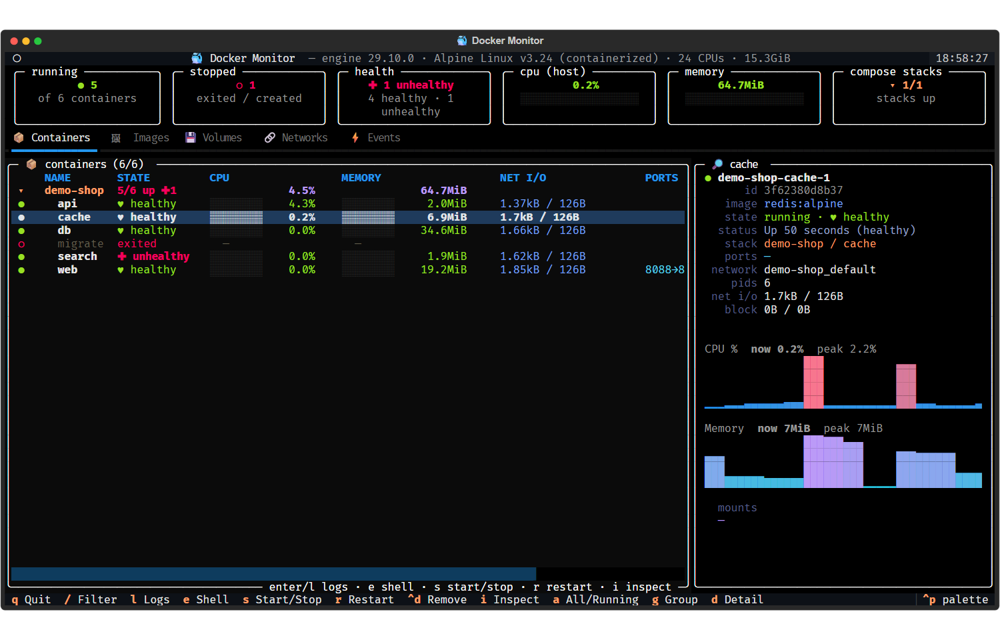
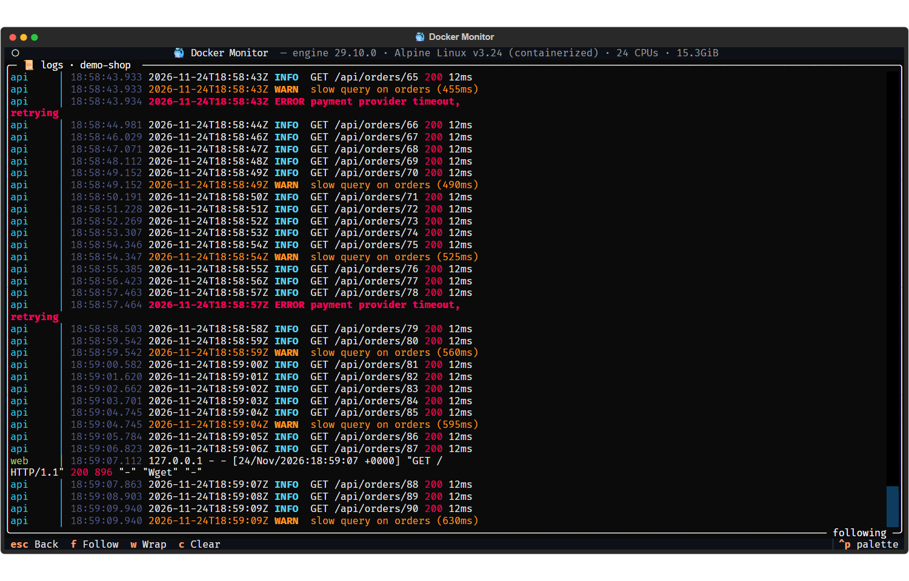
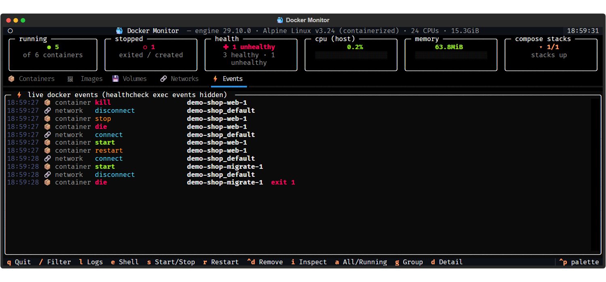

<div align="center">

# 🐳 Docker Monitor

**A colourful, interactive terminal dashboard for your local Docker stack.**
Think k9s, but for Docker and Docker Compose.

[](https://github.com/GD-HCK/docker-monitor/actions/workflows/ci.yml)


[](https://textual.textualize.io/)
[](https://claude.com/claude-code)



</div>

## Features

- **Live container table** grouped by compose project, with health, CPU, memory, network I/O and published ports, refreshed every couple of seconds.
- **Summary cards** for running, stopped and unhealthy containers, host CPU and memory, and compose stacks that are up.
- **Detail panel** with CPU and memory sparklines, image, network, mounts and PIDs for the selected container.
- **Streaming logs** for one container or a whole compose stack, interleaved and colour-coded per service, with `ERROR` and `WARN` lines highlighted.
- **Actions:** start, stop, restart, remove (with confirmation, volumes kept) and shell into containers. Actions on a stack header apply to every service in it.
- **Inspect** as syntax-highlighted JSON, with environment variable values hidden so secrets don't end up on screen.
- **Tabs** for images, volumes, networks and a live Docker event feed.
- **Filter** by name, image, stack or port, plus a command palette and themes.
- **Scriptable:** `--snapshot` prints a one-shot coloured summary and `--json` prints machine-readable output.

It only talks to the `docker` CLI, so it works wherever `docker ps` works: Docker Desktop on Windows and macOS, Docker Engine on Linux, remote engines via `DOCKER_HOST` or `docker context`.

| Stack logs, colour-coded per service | Live Docker events |
| --- | --- |
|  |  |

## Install

You need **Docker** and **Python 3.10+** (or [uv](https://docs.astral.sh/uv/), which brings its own Python). One command installs it and puts `docker-monitor` on your PATH:

**macOS / Linux**

```sh
curl -fsSL https://raw.githubusercontent.com/GD-HCK/docker-monitor/main/install.sh | sh
```

**Windows (PowerShell)**

```powershell
irm https://raw.githubusercontent.com/GD-HCK/docker-monitor/main/install.ps1 | iex
```

The installer uses `uv` if you have it, else `pipx`, else a private venv (`~/.local/lib/docker-monitor` or `%LOCALAPPDATA%\Programs\docker-monitor`) with a `docker-monitor` shim. It never needs `sudo` or admin rights. Run it again to upgrade.

<details>
<summary>Prefer to install it yourself?</summary>

```sh
uv tool install git+https://github.com/GD-HCK/docker-monitor
# or
pipx install git+https://github.com/GD-HCK/docker-monitor
# or run it once without installing anything
uv run https://raw.githubusercontent.com/GD-HCK/docker-monitor/main/docker_monitor.py
```

</details>

<details>
<summary>Uninstall</summary>

```sh
curl -fsSL https://raw.githubusercontent.com/GD-HCK/docker-monitor/main/install.sh | sh -s -- --uninstall
```

```powershell
& ([scriptblock]::Create((irm https://raw.githubusercontent.com/GD-HCK/docker-monitor/main/install.ps1))) -Uninstall
```

</details>

## Usage

```sh
docker-monitor               # the interactive dashboard
docker-monitor --snapshot    # one-shot coloured summary, then exit
docker-monitor --json        # one-shot JSON summary (for scripts)
```

### Keys

| Key | Action |
| --- | --- |
| `↑` `↓` / mouse | Select a container or a compose stack header (actions on a header apply to the whole stack) |
| `enter` / `l` | Follow logs (a stack header interleaves all its services); `f` pause, `w` wrap, `c` clear, `esc` back |
| `e` | Shell into the container (`bash`, else `sh`); `exit` returns to the dashboard |
| `s` | Start or stop (asks first) |
| `r` | Restart |
| `ctrl+d` | Remove (asks first; volumes are kept) |
| `i` | Inspect as highlighted JSON (environment values hidden) |
| `/` · `esc` | Filter by name, image, stack or port · clear the filter |
| `a` · `g` · `d` | All vs running only · group by stack · toggle the detail panel |
| `1`–`5` | Containers, Images, Volumes, Networks, Events tabs |
| `ctrl+p` | Command palette (themes, quit) |
| `q` | Quit |

## Try it on a demo stack

[`demo/compose.yaml`](demo/compose.yaml) starts a small fake shop: a web server, a chatty API, Redis, Postgres, an unhealthy search service and a failed migration job, so every colour in the dashboard shows up. The screenshots above were taken against it.

```sh
docker compose -f demo/compose.yaml up -d
docker-monitor
docker compose -f demo/compose.yaml down --volumes
```

## How it works

Docker Monitor is a single Python file built on [Textual](https://textual.textualize.io/). It reads everything from the `docker` CLI with `--format` templates: `docker ps` every couple of seconds for the table, plus background streams of `docker stats`, `docker events` and `docker logs --follow`. That means no Docker SDK, no socket permissions beyond what `docker` already has, and nothing to configure.

## Development

See [CONTRIBUTING.md](CONTRIBUTING.md). In short:

```sh
python -m venv .venv && . .venv/bin/activate   # Windows: .venv\Scripts\activate
pip install -e ".[dev]"
ruff check . && ruff format --check . && pytest
```

The end-to-end tests start (and remove) a throwaway `alpine` container, and they're skipped when no Docker engine is reachable.

## Built with Claude

Docker Monitor was designed and developed with [Claude Code](https://claude.com/claude-code), Anthropic's agentic coding tool, working alongside me: from the first prototype through the tests, screenshots, installers and this README.

## Licence

There's no licence file, so the default copyright applies: you're welcome to install and use Docker Monitor, read the code and open issues or pull requests.
